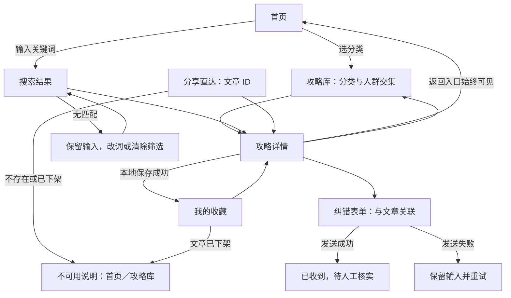

# 首期页面线框与关键流程

关联：[任务 #9](https://github.com/whyboy/hk-handbook/issues/9) · [Epic #8](https://github.com/whyboy/hk-handbook/issues/8)。

状态：线框交付，等待创始人评审。本文是设计说明，不代表已上线功能；不实现业务代码。线框中的攻略标题为交互示例，材料、费用、资格等事实留待 #10 的模板和 #11 的真实样稿核验，不作办理承诺。

## 评审导航

从[首页](#首页)选择分类进入[攻略库](#攻略库)，或输入关键词进入[搜索结果](#搜索结果)，再进入[攻略详情](#攻略详情)。从[我的](#我的)打开本设备收藏。按文末走查脚本逐项评审；以下链接均为本文页面线框导航，按钮描述代表后续产品行为。

## 页面与共享规则

底部导航为「首页 / 攻略 / 我的」，仅三个顶层页面显示，当前项高亮。搜索、详情使用顶部返回；直接打开分享详情时始终可返回首页或攻略库。返回列表保留关键词、分类、人群和滚动位置。

免登录阅读、搜索和分享；不要求用户声明身份。人群筛选为「全部 / 游客 / 人才用户 / 家庭」，默认全部，允许单选。攻略可具有多个人群标签，标签用于说明适用情境，不构成资格认定。切换分类保留人群条件并显示当前筛选，提供「清除筛选」。分类与关键词及人群条件按交集处理。

文章卡片显示标题、摘要、主题、适用标签和事实核验日期。日期未知显示「尚未核验」，不以编辑日期替代。字段与 [#10 的内容规范提案](https://github.com/whyboy/hk-handbook/blob/4675b33/docs/content/STANDARD.md) 对齐。人群稳定值为 visitor／talent／family，人才用户包含高才、优才等相关情境；具体资格必须另写适用条件。仅内部评审示例允许出现“尚未核验”；生产环境关键事实未经人工核验的草稿不进入列表、搜索或公开详情。

## 首页

```text
┌ 香港攻略（暂定名）────────────────┐
│ [搜索攻略：输入关键词           ] │
│ 按主题查找                       │
│ [银行卡]   [电话卡]   [交通]      │
│ 适用人群 [全部 ▾]                │
│ 攻略入口                         │
│ 标题 / 摘要 / 主题 / 适用标签     │
│ 事实核验：日期或尚未核验          │
│ [查看攻略]                       │
│ [查看全部攻略]                   │
├ [首页●]      [攻略]      [我的] ─┤
└─────────────────────────────────┘
```

选择主题跳转攻略库并应用主题条件；搜索提交进入结果页，空白输入提示「请输入关键词」，不发起搜索。首页的攻略入口仅展示已发布内容，不引入推荐算法或额外工具入口。

## 攻略库

```text
┌ 攻略库 ─────────────────────────┐
│ [搜索攻略                     ] │
│ [全部] [银行卡] [电话卡] [交通] │
│ 人群：[全部 ▾]  [清除筛选]      │
│ 当前：交通 · 游客               │
│ 攻略标题                       │
│ 摘要 / 交通 / 游客、家庭        │
│ 事实核验：日期或尚未核验        │
│ [查看攻略]                     │
│ [加载更多] / 已显示全部         │
├ [首页]       [攻略●]    [我的] ─┤
└────────────────────────────────┘
```

[打开详情](#攻略详情)。主题总览与列表合并为一个页面，避免重复层级。没有匹配分类或人群时显示「暂无符合条件的攻略」，提供清除筛选。加载更多失败保留已有卡片，并允许重试。

## 搜索结果

```text
┌ [返回] 搜索 ────────────────────┐
│ [交通                     ][搜] │
│ 分类 [全部 ▾]  人群 [全部 ▾]   │
│ “交通”的搜索结果               │
│ 标题 / 摘要 / 分类 / 适用标签   │
│ 事实核验：日期或尚未核验        │
│ [查看攻略]                     │
└────────────────────────────────┘
```

搜索沿用发起页面的筛选并显式显示；用户可清除筛选或修改关键词。结果卡片进入[详情](#攻略详情)。无结果时保留输入，显示「没有找到相关攻略，试试其他关键词或清除筛选」，提供清除筛选及[浏览全部攻略](#攻略库)。不把请求失败显示为无结果。

## 攻略详情

```text
┌ [返回]             [首页][攻略库] ┐
│ 攻略标题                         │
│ 摘要 / 主题 / 适用标签            │
│ 适用条件及限制                   │
│ 事实核验：日期或尚未核验          │
│ 发布日期 / 编辑日期              │
│ 目录：准备 / 步骤 / 费用耗时      │
│       注意事项 / 来源            │
│ 准备事项（材料等）                │
│ 操作步骤（编号顺序）              │
│ 费用与耗时（附适用条件）          │
│ 注意事项（区分事实与个人经验）    │
│ 来源：名称 / 官方链接 / 查阅日期  │
│ 待核验信息及适用限制              │
│ [收藏 / 已收藏] [分享] [反馈纠错] │
└──────────────────────────────────┘
```

正文较长时通过目录跳转对应段落；不适用字段保留“不适用 + 原因”；未知写“待核验”，不能用“无需”或空值替代。文章级核验日期使用所有仍有效关键事实中最早的人工核验日期，编辑时间不刷新核验日期。官方来源保留可识别名称及完整链接，平台无法打开时提供复制链接。

收藏成功后按钮改为「已收藏」，提示「已收藏到本设备」；再次点击取消，改为「收藏」并提示「已取消收藏」。写入失败保持原状态并提示「收藏未保存，请重试」，不显示成功。收藏状态在详情和我的页面一致。

分享指向稳定文章标识对应的详情，不指向首页、不携带身份或本地收藏。H5 提供复制链接；支持系统分享的浏览器可额外调用系统分享，用户取消不报成功。微信小程序提供原生转发；分享路径包含文章标识。复制失败时显示可选中的完整链接及手动复制说明。分享接收者未登录即可阅读，并能进入首页或攻略库。

纠错入口打开表单：关联文章（只读）、问题类型（事实有误 / 信息过期 / 链接失效 / 其他）、问题说明（必填）、参考来源（选填）。提示不要填写证件、电话等个人敏感信息。空说明在字段旁提示；发送中禁用重复提交；成功显示「已收到反馈，待人工核实」，失败保留输入并提供重试。未提交退出需确认是否放弃输入。无登录、无强制联系方式，不承诺审核时限；本文只定义入口及结果表达，不提供真实提交服务。

## 我的

```text
┌ 我的 ───────────────────────────┐
│ 无需登录，收藏仅保存在本设备     │
│ 我的收藏                        │
│ 标题 / 主题 / 标签 / 核验日期    │
│ [打开攻略] [取消收藏]           │
│ 提示：清理数据可能丢失收藏       │
├ [首页]       [攻略]    [我的●] ─┤
└────────────────────────────────┘
```

没有收藏显示「还没有收藏攻略」，提供[去浏览攻略](#攻略库)。取消后移除对应卡片，最后一项取消后显示空状态。已收藏文章下架时保留条目并标记「内容已不可用」，可取消收藏；打开后进入不可用状态，不继续展示旧正文。

H5 收藏限当前浏览器及站点存储，小程序收藏限当前设备的小程序存储；两端不互通、更换设备不迁移，清除浏览器数据、卸载小程序等可能导致丢失。隐私模式或存储不可用时明确提示保存失败，不要求登录兜底。我的页面不放登录、会员、订单等空入口。

## 异常与等待状态

| 场景 | 页面表达 | 可用操作 |
| --- | --- | --- |
| 首次加载 | 内容区域显示加载中，保留导航 | 返回、切换顶层页面 |
| 首次加载失败 | 无法加载，请检查网络后重试 | 重试、返回首页 |
| 搜索无结果 | 保留关键词和筛选，说明无匹配 | 改词、清除筛选、浏览全部 |
| 无收藏 | 还没有收藏攻略 | 去浏览攻略 |
| 文章不存在或已下架 | 内容不存在或已下架，不显示旧正文 | 首页、攻略库；已有收藏可取消 |
| 分享或收藏失败 | 就地提示失败，保持之前状态 | 重试或复制链接备用方式 |
| 纠错发送失败 | 保留全部输入，不提示已收到 | 重试、返回 |

微信中的外链跳转受平台能力及配置约束，不能直接打开时复制官方链接到浏览器；H5 可直接打开外部来源。具体平台配置属于后续开发验证，不把原型视为真机验收。

## 关键路径与评审脚本

| 编号 | 起点与操作 | 预期结果 |
| --- | --- | --- |
| 1 | 首页 → 交通 → 游客 → 卡片 | 交通与游客交集列表进入详情，展示适用限制及核验信息 |
| 2 | 首页搜索 → 搜索结果 → 卡片 → 返回 | 进入详情，返回后关键词及筛选保留 |
| 3 | 搜索无结果 → 清除筛选 | 重新查询；仍无结果可修改关键词或浏览全部 |
| 4 | 详情收藏 → 我的 → 打开 → 取消收藏 | 同一设备状态一致，最后一项取消后显示空状态 |
| 5 | 直接打开分享详情 → 攻略库或首页 | 无需登录，不依赖历史页面栈 |
| 6 | 详情 → 纠错 → 空提交 → 填写 → 发送 | 必填提示、发送中、成功或保留输入失败状态清楚 |
| 7 | 已下架的分享链接或收藏 → 打开 | 不显示旧正文，有返回路径，收藏可移除 |
| 8 | 列表加载失败 → 重试 | 失败区别于空列表，重试后恢复内容 |
| 9 | 拒绝本地存储后收藏 | 不伪报成功，原按钮状态不变 |
| 10 | 游客与人才用户分别筛选 | 无身份填写要求，标签不表示资格审核 |

以上为静态线框走查脚本，非已执行的应用自动化测试。真实内容阅读长度验证由 #11 完成。可填写的人工走查结果见 [E01-T01-REVIEW.md](E01-T01-REVIEW.md)。

## 待确认与评审记录

| 项目 | 当前提案 | 影响与责任 |
| --- | --- | --- |
| 产品名与视觉 | 暂用香港攻略，线框不确定品牌色 | 创始人评审；不阻塞线框讨论 |
| 内容字段与标签 | 已对齐 #10 / PR #15 的字段提案 | 创始人审核规范；业务开发前确认 |
| 纠错范围及长度限制 | 匿名反馈，说明必填，不收集联系方式 | 创始人确认；后续实现确定防滥用、存储与隐私规则 |
| 内容顺序与长文体验 | 摘要、条件、核验信息前置，正文目录导航 | #11 用真实样稿评审 |
| 创始人原型评审 | 尚未执行，未收到反馈 | 阻塞任务最终验收；不能标记评审通过 |

评审者请按上述十条路径记录「编号 / 通过或问题 / 修改意见」。收到反馈后在本表追加实际日期、评审者、意见、处理位置或待办链接；当前没有真实评审结论。PR 提交用于评审，不等同于全部验收完成。


## 页面字段与内容规范对应

| 内容规范字段 | 原型位置 | 表达要求 |
| --- | --- | --- |
| 标题、摘要、分类、人群 | 列表卡片与详情顶部 | 列表不显示用户身份，不把标签当资格证明 |
| 适用条件及不适用情境 | 详情摘要后、步骤前 | 在操作前说明范围，不能藏在文末 |
| 准备、步骤、费用耗时、注意事项 | 详情目录与正文 | 未知与不适用区分；事实标来源编号 |
| 官方事实、经验、编辑建议 | 正文相关段落 | 经验要时间与情境，建议不能冒充官方规定 |
| 来源及查阅记录 | 来源区，正文以 S1/S2 等编号关联 | 精确链接；查阅和人工核验分开 |
| 发布／编辑／事实核验日期 | 详情分别显示；列表只显示事实核验 | 草稿仅内部评审；未发生的日期不虚填 |
| ID、内容状态 | 分享、收藏、下架页 | 文章改名仍保持链接；下架不展示旧正文 |

## 状态与关键跳转



该图描述未来产品行为，不代表已接入后台。线框走查可以点击本文标题锚点切换页面；收藏、分享、纠错的按钮行为按脚本人工推演，不能称为已通过真机交互测试。
